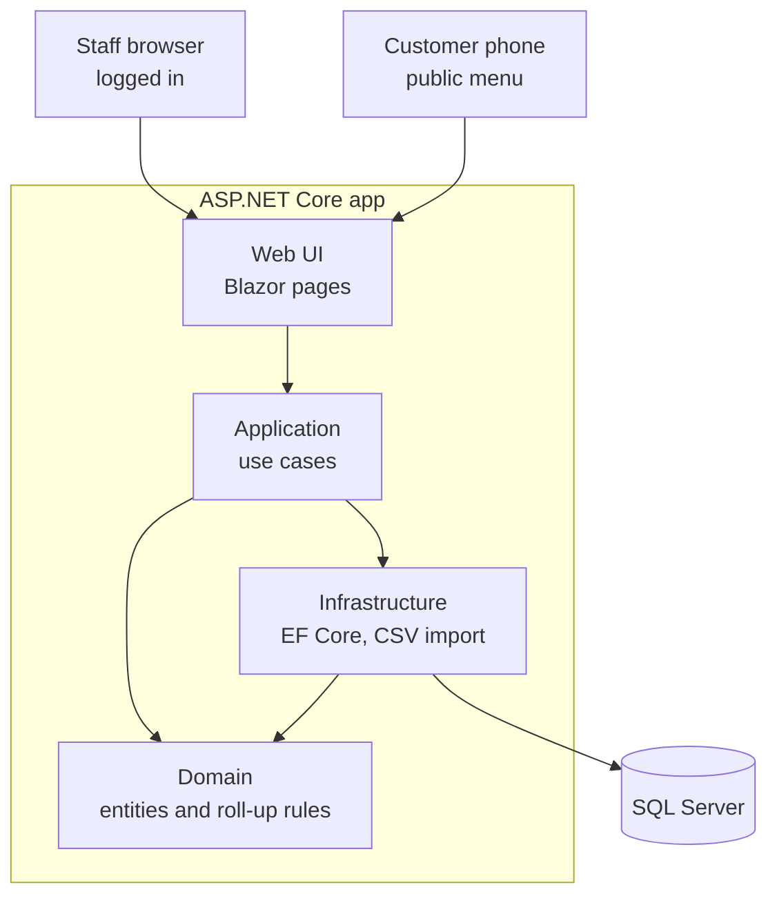
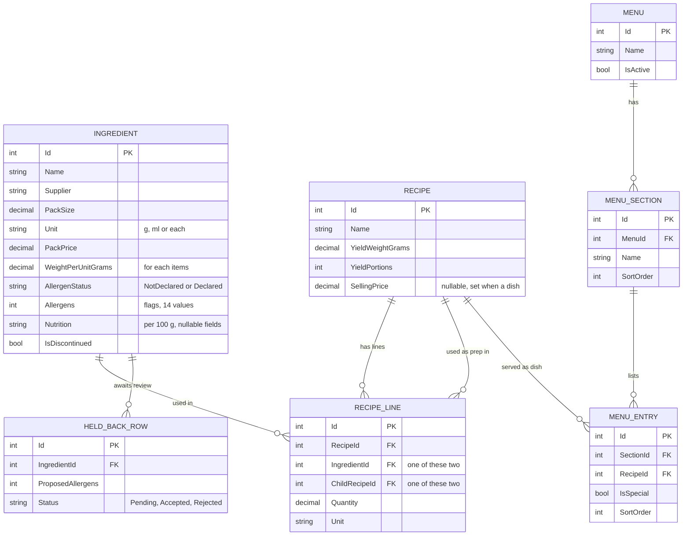
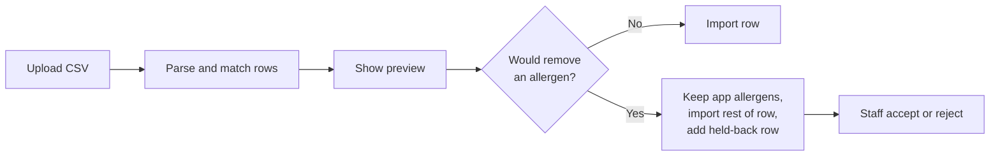

# Café Kitchen App — Technical Architecture (MVP)

**Status:** Draft, awaiting approval
**Input:** `01-requirements.md` (F1–F8, B1–B8, N1–N6)
**Next step:** Step 3, scaffold the solution

---

## 1. Summary

The app is a single ASP.NET Core application (a "modular monolith") using Blazor for the UI, Entity Framework Core for data access, and a SQL database. It follows Clean Architecture: the domain rules (allergen, nutrition and cost roll-ups) live in a project with no dependency on the UI or the database, so they can be unit tested in isolation.

Microservices, a separate SPA frontend and multi-tenancy are deliberately not used. They add cost without benefit for a single-café MVP.

## 2. System overview



## 3. Technology stack

| Concern | Choice | Notes |
| --- | --- | --- |
| Runtime | .NET 10 (LTS) | Long-term support release |
| Web framework | ASP.NET Core Blazor Web App | One project for all UI |
| Public menu rendering | Static server-side rendering | Plain HTML: fast, accessible (N3, N5) |
| Staff screens | Interactive Server render mode | Rich forms without a JavaScript framework |
| Data access | Entity Framework Core 10 | Code-first with migrations |
| Database | SQL Server (Docker or LocalDB for development) | PostgreSQL also supported by EF Core |
| Authentication | ASP.NET Core Identity | Staff accounts only (N4) |
| CSV import | CsvHelper | Supplier import (F2) |
| Unit tests | xUnit | Domain and Application layers |
| Integration tests | xUnit + Testcontainers | Real SQL Server in Docker |
| CI | GitHub Actions | Build and test on every pull request |

## 4. Solution structure

```
CafeKitchen.sln
├── src/
│   ├── CafeKitchen.Domain/          Entities, value objects, roll-up rules
│   ├── CafeKitchen.Application/     Use cases, interfaces, DTOs
│   ├── CafeKitchen.Infrastructure/  EF Core DbContext, migrations, CSV parsing
│   └── CafeKitchen.Web/             Blazor pages, Identity, startup
├── tests/
│   ├── CafeKitchen.Domain.Tests/
│   ├── CafeKitchen.Application.Tests/
│   └── CafeKitchen.IntegrationTests/
├── docs/
│   ├── 01-requirements.md
│   ├── 02-architecture.md
│   └── 03-backlog.md
└── CLAUDE.md
```

## 5. Layers and the dependency rule

Dependencies point inward only. The compiler enforces this through project references.

| Layer | Responsibility | May reference |
| --- | --- | --- |
| Domain | Entities and business rules B1–B8. No I/O. | Nothing |
| Application | Use cases such as "import supplier CSV" or "add dish to menu". Defines interfaces like `IRecipeRepository`. | Domain |
| Infrastructure | Implements the Application interfaces with EF Core and CsvHelper. | Application, Domain |
| Web | UI, authentication, dependency injection setup. | Application, Infrastructure (for DI only) |

The Web layer never calls the database directly, and the Domain layer never knows a database exists.

## 6. Domain model



Key modelling choices, following the glossary:

- **One `Recipe` entity.** Prep and dish are roles derived from usage (appearing in a `RecipeLine` or a `MenuEntry`), not separate classes or tables.
- **Allergens as a `[Flags]` enum** of exactly the 14 UK/EU allergens, plus a separate `AllergenStatus`. This keeps "declared none" distinct from "not declared" (B1).
- **`Nutrition` as an owned value object** stored in the ingredient's table, with each nutrient nullable so missing data is explicit (B4).
- **A recipe line references either an ingredient or a child recipe**, never both. A database check constraint enforces this.

The 14 allergens: celery, cereals containing gluten, crustaceans, eggs, fish, lupin, milk, molluscs, mustard, tree nuts, peanuts, sesame, soya, sulphur dioxide and sulphites.

## 7. The roll-up engine

The roll-up is a pure domain service, `RecipeRollUpCalculator`, that walks a recipe's tree recursively and returns one result:

```csharp
public sealed record RollUpResult(
    Allergen Allergens,          // union of everything inside (B2)
    bool AllergensConfirmed,     // false if anything is not declared, at any depth
    NutritionResult Nutrition,   // per 100 g and per portion, plus missing ingredients (B4)
    decimal BatchCost,           // B6
    decimal PortionCost,
    bool UsesDiscontinued);      // B7
```

Design decisions:

- **Calculated on demand, not stored.** A single café's data is small, so recursion with per-request memoisation is fast enough and can never go stale (F4.4). Caching can be added later if measurements show a need.
- **Unit conversion (B3)** happens once per line: ml counts as g, and "each" uses `WeightPerUnitGrams` for ingredients or yield weight divided by portions for preps.
- **Cycle prevention (F3.3)** is a depth-first search run before any recipe line is saved. A cycle is rejected with a validation error.
- **Generic by design.** Each rolled-up property follows the same pattern, so carbon (phase 2) is an addition rather than a rewrite.

## 8. Key flows

**Supplier import (F2, B8)**



**Public menu with allergy filter (F7, B5)**

The page is rendered on the server. The ticked allergens are passed in the query string, so filtering works without JavaScript and the result can be bookmarked. For each dish, the filter outcome is: "contains" if any ticked allergen is present, else "not confirmed" if allergens are not confirmed, else "none declared".

## 9. Security

- Every staff page requires login through ASP.NET Core Identity. The default policy is "authenticated", with the public menu explicitly marked anonymous.
- The public menu reads only active menus and exposes no staff data.
- Staff can create other staff accounts (no separate admin role in the MVP).
- HTTPS only, with anti-forgery protection on forms (Blazor default).

## 10. Testing strategy

| Level | Scope | Tooling | Target |
| --- | --- | --- | --- |
| Unit | Domain rules B1–B8, including recipes at least 3 levels deep | xUnit | Every business rule covered (N2) |
| Unit | Application use cases, with fake repositories | xUnit | Main success and failure paths |
| Integration | EF Core mappings, migrations, import end to end | xUnit + Testcontainers | One test per feature area |
| Accessibility | Public menu | Manual check plus an automated axe scan | WCAG 2.2 AA (N3) |

Tests for the allergen rules use named scenarios that mirror the business language, for example `Recipe_with_undeclared_ingredient_three_levels_deep_is_not_confirmed`.

## 11. Build and deployment

- **Development:** `dotnet run` against SQL Server in Docker. EF Core migrations create the schema.
- **CI:** GitHub Actions runs build and all tests on every pull request. A failing test blocks the merge.
- **Hosting (proposed):** Azure App Service with Azure SQL, or any Docker host. To be confirmed before release.
- **Backup:** CSV export of ingredients and recipes (N6), plus the database provider's own backups.

## 12. Architecture decision records

| ID | Decision | Reason |
| --- | --- | --- |
| ADR-001 | Single ASP.NET Core app, not microservices | One café, one team; simpler to build, test and deploy |
| ADR-002 | Clean Architecture with four projects | Keeps safety-critical rules testable in isolation |
| ADR-003 | Blazor instead of a separate SPA | One language and one deployable; server rendering suits the public menu |
| ADR-004 | Roll-ups calculated on demand | Small data volume; results can never be stale |
| ADR-005 | Allergens as flags enum plus explicit status | Enforces "not declared is not none" in the type system |

## 13. Open decisions

- **Frontend:** Blazor is recommended. Switch to a React or Angular SPA with a Web API only if the team already works in those.
- **Database:** SQL Server is assumed. PostgreSQL is a drop-in alternative if hosting cost matters.
- **Hosting:** to be decided before release.

## 14. Approval

- [ ] Stack and frontend choice agreed
- [ ] Solution structure agreed
- [ ] Domain model agreed
- [ ] Approved to start Step 3 (scaffolding)
